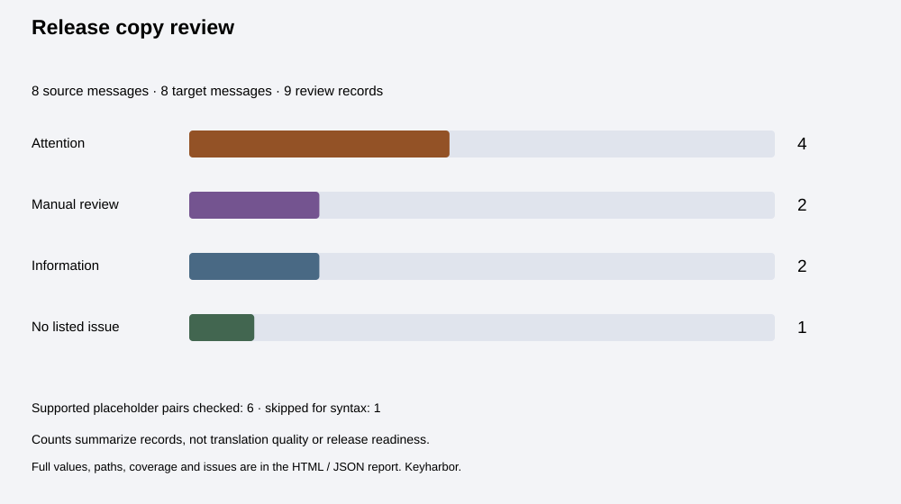

# Keyharbor

**Keep the words different. Keep the wiring aligned.**

Review two nested JSON locale dictionaries locally. Find missing paths, blank translations, object/string shape changes and supported interpolation differences, with a complete read-only receipt.



*Generated summary SVG from the included comparison, not an editor screenshot.*

## Features

- Strict nested JSON objects with string leaves; decoded duplicate keys reject instead of silently replacing values.
- JSON Pointer paths preserve literal dots, slashes, tildes, empty key names and Unicode identity.
- Missing/extra paths, blank targets and object/string conflicts, with complete conflicting subtrees.
- A documented default-interpolation subset: variable names, dotted names and escaped/unescaped markers.
- Explicit manual-review coverage for unsupported brace syntax and detected nesting/printf forms.
- Identical-text and occurrence-count notes that are informational, not translation verdicts.
- Search, severity filters and 20-record pages with **complete unfiltered exports**.
- Editable project JSON, full report JSON, printable HTML and a count-summary SVG.

No account, analytics, application uploads, paid APIs or runtime dependencies. This tool does not translate or patch your dictionaries.

## Run locally

Node.js 22 or 24 and npm:

```sh
npm ci --ignore-scripts --no-audit --no-fund
npm test
npm run example
npm run build
npm run dev
```

Open **http://127.0.0.1:4200**. The local server binds only to loopback and serves allowlisted built files. Rebuild after source changes.

jsdom is used only for development tests. The static build uses Node built-ins.

## Review a comparison

1. Label the comparison, reference dictionary and candidate dictionary.
2. Paste JSON or open a JSON dictionary in each editor. Dictionary files fill drafts; they do not automatically replace the analyzed report.
3. Select **Analyze dictionaries**. Both dictionaries must validate before the report updates.
4. Review attention records, manual-review records and the scan details. Filters and search affect the visible view only.
5. Save project JSON to resume. Download full report JSON or HTML for the complete handoff. Open the HTML to print / save as PDF.

Invalid input preserves the previous analyzed report. While drafts exist, the report is labeled as the last analyzed input and downloads are disabled. Analyze or revert the drafts first.

Example: source `Saved {{item}}` versus target `Saved {{modelId}}` reports missing `item` and extra `modelId`. Reordering a supported marker preserves its name. A missing message is retained as a missing-path record rather than being omitted.

## Scope and interpretation

### Supported interpolation subset

The check recognizes:

- `{{name}}` and surrounding marker whitespace
- Dot-separated names such as `{{user.name}}`
- Unescaped marker syntax such as `{{-name}}`

Each name segment must match ASCII letters/underscore followed by letters/digits/underscore. Names and case are compared exactly.

A changed variable name needs attention. Different escaped/unescaped marker presence needs review; runtime escaping options are not assessed. Different occurrence counts are informational because translation can legitimately repeat a variable differently.

Formatted markers such as `{{value, number}}`, ICU-style braces, malformed braces and detected `$t(...)` nesting cause that matched pair’s **placeholder comparison to be skipped**. Scan details retain any recognized tokens and explain the limit; partial token scans do not produce missing-variable claims.

Detection of other formats is conservative and incomplete. You must select inputs that use this subset: arbitrary custom delimiters, all printf variants, runtime plugins and alternate interpolation conventions are not discovered or validated. Literal braces can trigger a manual-review note.

Markup-like text gets a review note. Tags, attributes and rendering are not validated; all content is shown literally. The tool does not execute i18next or render message HTML.

### What the record levels mean

| Level | Meaning |
| --- | --- |
| Attention | Missing/extra path, object/string conflict, nonblank-source/blank-target, or a supported missing/extra variable |
| Manual review | Unsupported syntax, markup, changed escape-marker presence, or a blank source |
| Information | Identical nonblank text or changed variable occurrence counts; either can be intentional |
| No listed issue | This record produced no issue in the supported checks; not a translation or release approval |

A record uses its highest issue level and can contain several notes. Shape conflicts preserve the entire source/target subtrees in one record. Missing/extra subtrees expand into string leaves and empty-object records. Every source and target string is covered exactly once, including messages inside shape conflicts.

Counts refer to records, not a translation quality score. Missing, extra and shape-conflict records do not receive placeholder comparison. Empty objects contain zero messages.

### Literal path identity

Paths follow [JSON Pointer](https://www.rfc-editor.org/rfc/rfc6901). They are displayed as JSON strings, so the root `""` and an empty key `"/"` remain distinct.

| Dictionary key | Pointer |
| --- | --- |
| Literal `"menu.title"` | `/menu.title` |
| Nested `{"menu":{"title":"…"}}` | `/menu/title` |
| Literal `"a/b"` | `/a~1b` |
| Literal `"m~n"` | `/m~0n` |

There is no Unicode normalization. i18next key separators, plural suffix conventions and runtime lookup rules are not inferred.

## Handoff files

| Export | Includes |
| --- | --- |
| Project JSON | Exact original editor text, labels and comparison title; reopen to edit |
| Report JSON | Entire project, summary, every record/value/subtree, placeholder tokens and coverage |
| Review HTML | All records, scan details and complete original dictionaries; independent of filters/pages |
| Summary SVG | Counts and coverage only; use HTML/JSON for messages and issues |

Actual invented examples: [project](examples/copy-project.json), [report](examples/copy-report.json), [HTML](examples/copy-review.html), [SVG](examples/copy-summary.svg). These are not production translations.

Opening a project replaces the comparison and is undoable. The 25-action history exists only during the session. No translated file, merge patch or code change is generated.

## Privacy and limits

Everything entered stays in browser memory. There is **no autosave**. Closing or refreshing loses changes unless you saved project JSON. The host receives ordinary asset requests; the application does not upload dictionaries. Exported reports contain full original content, so share them deliberately.

Per dictionary: 400,000 raw UTF-16 units, 500 string messages, 3,000 nodes, path depth 12, keys up to 256 units, string values up to 4,000 units, and 150,000 decoded units total across keys and values. Arrays, numbers, booleans, null, comments and trailing commas are unsupported. Duplicate decoded names reject even when their escape spellings differ.

Dictionary files must be valid UTF-8 and at most 1,600,000 bytes. Comparison project files allow 2,000,000 raw units / 8,000,000 UTF-8 bytes and exactly this schema’s fields. Titles allow 80 units; source/target labels allow 48. Unpaired Unicode surrogates reject.

A newer file, input edit or analyzed comparison invalidates an older in-flight read. Open dictionary files one at a time; if another read updates the editor first, choose the superseded file again.

There is no translation, grammar judgment, semantic completeness check, unused-code-key scan, plural-category validation, ICU parser, markup validator, runtime compatibility test or security/release-readiness guarantee.

## Verification

`npm test` covers strict string decoding, decoded duplicate names, prototype-like literal keys, JSON Pointer identity, parser bounds, supported and skipped placeholder syntax, whole-subtree message accounting, 60 generated comparisons, 500-message payloads, literal Unicode/markup exports, bounded history, strict UTF-8 files, actual workbench event handlers, full downloads under filters/pagination and asynchronous file races.

CI runs Node 22/24 on Windows and Linux. UI tests use **jsdom, a simulated DOM**. Native browser interaction, responsive visual rendering, assistive technology, native download destinations, physical print output and an actual editor screenshot have not been verified. The image above is a generated summary export.

## Deploy on Vercel

Import the repository, choose framework **Other**, Node **24.x**, build command `npm run build`, output directory `dist`, and an empty install command. No environment variables or paid services are needed. The included `vercel.json` sets static build options and security headers.

## Code and format

`src/json.mjs` parses strict dictionaries and builds paths; `placeholders.mjs` defines the supported subset; `compare.mjs` reconciles messages; `export.mjs` emits complete literal reports; `app.mjs` manages drafts and review views; `handoff.mjs` guards files and URLs.

[File-format notes](docs/file-format.md). Interpolation terminology follows the [official i18next documentation](https://www.i18next.com/translation-function/interpolation); Keyharbor is an independent subset checker. MIT licensed.
